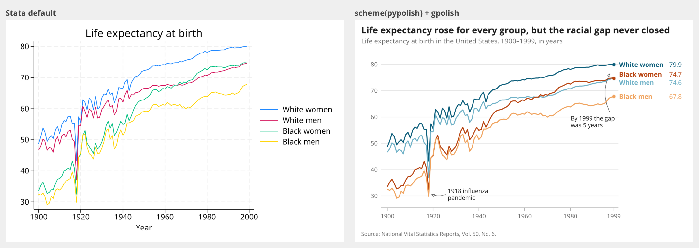
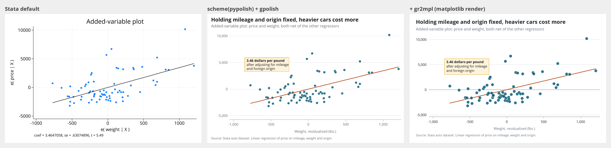
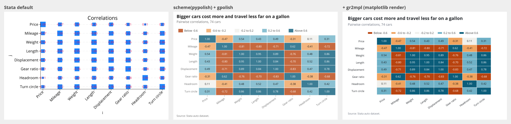
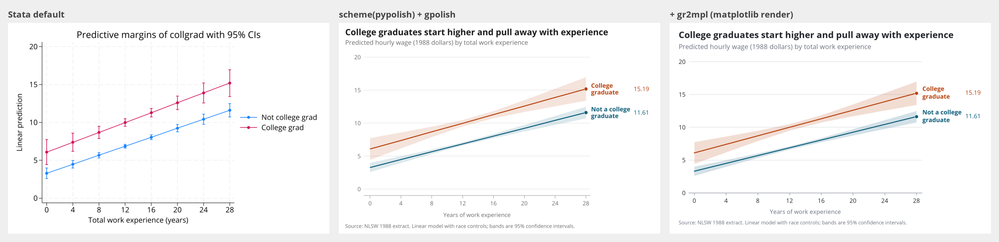
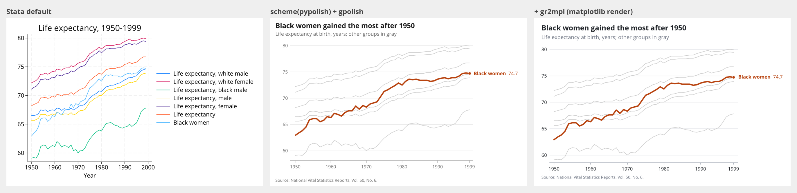
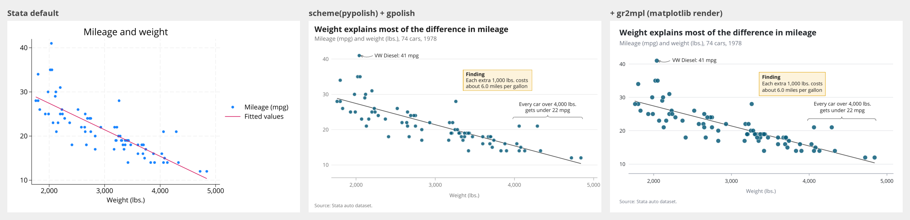
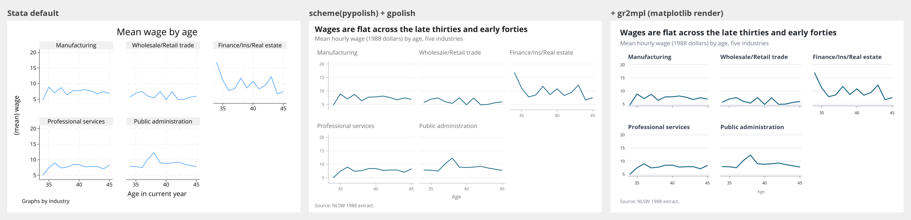
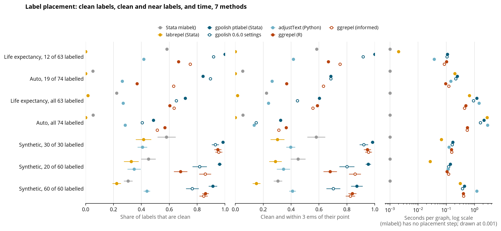

# gpolish

**Make Stata graphs look like the clean charts people build in Python and R.** `gpolish` edits a Stata graph after it is drawn: it labels lines directly, places notes and point labels where they fit, and tidies the axes and title. A companion command, `gr2mpl`, redraws any supported Stata graph in matplotlib when you want effects Stata cannot draw.



*Left: Stata's default look. Right: the same graph with `scheme(pypolish)`, a few graph options (line colours, subtitle, note, axis labels) and four `gpolish` commands: the title edit, end labels and two callouts. Both are Stata graphs, and both use the series labels set with `label var`. The code is [gallery example 04](gallery/README.md#multi-series-lines).*

## What is in the package

| Piece | What it does | Output |
|---|---|---|
| `scheme(pypolish)` | Static defaults: white background, left-aligned titles, light horizontal grid, horizontal axis labels, a restrained palette. | Stata graph |
| `gpolish` | Reads the drawn graph and adds direct labels, callouts, point labels and brackets. A layout step places them clear of markers, lines, bars, shaded areas, range plots, `xline()` and `yline()` reference lines, labels added earlier and the edges of the plot. | Stata graph |
| `gr2mpl` | Redraws the graph held in memory with matplotlib, including every `gpolish` edit. Handles `graph bar`, box, dot, `graph matrix`, `by()` and combined graphs too. | PNG, PDF, SVG or JPG image |

`gpolish` needs only Stata. `gr2mpl` needs Python with matplotlib 3.6 or later and numpy.

## Install

```stata
net install gpolish, from("https://raw.githubusercontent.com/ericabooth/gpolish-stata-public/main/") replace
help gpolish
```

Requires Stata 16 or later. One install brings both commands, the scheme and the help files.

For `gr2mpl`, check the Python setup once:

```stata
gr2mpl doctor
```

It reports which interpreter it will use and whether its matplotlib is 3.6 or later, and prints the `pip install` line if matplotlib is missing. With an older matplotlib, `gr2mpl` stops with error 601 and prints the `pip install --upgrade` line. To choose an interpreter, put `global GR2MPL_PYTHON "/path/to/python"` in your `profile.do`.

## Quick start

The second line sets the font of the Graph window. Stata saves every `graph set` setting, so the new font stays in force in later sessions, and Stata has no form of the command that lasts for one session only. To keep your current font, leave the line out; to see it first, type `graph set window`.

```stata
sysuse uslifeexp, clear
graph set window fontface "Open Sans"      // saved for later sessions; any installed font
line le_wfemale le_wmale le_bfemale le_bmale year, scheme(pypolish) legend(off) ///
    xsize(7) ysize(4.6) title("Life expectancy rose for every group", size(13.5pt))

gpolish                                    // bold title, drop the y-axis line and ticks
gpolish endlabel, values dots              // direct labels, pushed apart where they collide
gpolish callout "1918 influenza" "pandemic", to(1918.6 30.6)   // placed automatically

graph export life.png, width(2400) replace // still a Stata graph
gpolish render, saving(life_mpl.png) replace    // optional matplotlib version
```

In batch mode (`stata -b`) and console Stata there is no Graph window, so `graph set window fontface` is not available. Stata then exports PNG files with the font set by `graph set svg fontface`, and `gpolish` reads that setting instead; to use Open Sans there, run `graph set svg fontface "Open Sans"`. To name the font yourself, for example for PDF export, set `global GPOLISH_FONT "Open Sans"`, which overrides both settings. Like the window font, the svg font is saved for later sessions; a global macro lasts for the current session only.

| Command | Use |
|---|---|
| `gpolish` | Bold title; remove the y-axis line and tick marks. |
| `gpolish endlabel` | Label each line at its end in the line's colour; `values`, `dots`, `wrap()`, `side(left)`, `color()`. Lines on a second y axis are labelled at their own scale. Running it again replaces the earlier labels, also after `graph save` and `graph use`. |
| `gpolish callout` | A note with a curved arrow. Leave out `at()` and it finds its own place. |
| `gpolish note` | A shaded box for a finding or call-out, with an optional arrow. |
| `gpolish brace` | A curly brace with a label: mark a confidence interval, a gap or a range. |
| `gpolish arrow` | A straight or curved arrow; with `note` it builds simple flow charts. |
| `gpolish ptlabel` | Label chosen scatter points, each in the least crowded of eight positions; crowded labels move out on a leader line. |
| `gpolish bracket` | A square bracket between two y values, with an optional label. |
| `gpolish legend` | Colour legend text to match its keys. |
| `gpolish clear` | Remove everything the layout commands added, and undo `endlabel`'s margin and legend changes. |
| `gpolish render` | Hand the finished graph to `gr2mpl`. |
| `gpolish limits` | List what Stata's renderer cannot draw. |
| `gpolish geom` | Report the drawn geometry (size, plot box, data-to-device transform) in `r()`, for programmers. |

Positions in `at()`, `to()` and `from()`, and bracket's `x()`, `y0()` and `y1()`, may be expressions, so a note on a date axis can be written `to(td(21sep2001) 966)`. An expression may use the results of the previous command, such as `to(1999 r(max))` after `summarize`; `gpolish` leaves `r()` as it found it, except after `gpolish geom` and `gpolish render`. Positions are read on the first x and y axes. On a graph with a second axis, the options `xaxis(#)` and `yaxis(#)` of `callout`, `note`, `arrow`, `brace`, `bracket` and `ptlabel` say which axis a position belongs to.

Because `gpolish` reads the drawn graph and not your command, it also works on graphs made by other commands that produce twoway graphs, such as `marginsplot`.

## Gallery

Twenty-two examples, each drawn three ways: Stata's default, `pypolish` + `gpolish`, and the `gr2mpl` render.

- **[Browse the gallery](https://ericabooth.github.io/gpolish-stata-public/gallery/)** (page with full-size images and code)
- [Gallery on GitHub](gallery/README.md)











The gallery covers lines, scatters, `marginsplot`, coefficient and added-variable plots, histograms, bars, box plots, `by()` panels, combined graphs, a flow chart, a heatmap, a scatterplot matrix, a dendrogram, and output from the community commands `coefplot`, `statplot` and `heatplot`.

All gallery images come from one script, [gallery/gallery.do](gallery/gallery.do).

## When to use which

| | `pypolish` + `gpolish` | `gr2mpl` |
|---|---|---|
| Result | A Stata graph: editable, combinable, exports to any format | An image file: PNG, PDF, SVG or JPG, set by the `saving()` extension |
| Needs | Stata 16+ | Stata 16+, Python, matplotlib 3.6+, numpy |
| Graph families | twoway (title edit on any family) | twoway, bar, box, dot, matrix, `by()`, combine |
| Ceiling | Stata's renderer | Anything matplotlib can draw |

Start with the scheme and `gpolish`. Use `gr2mpl` when a chart needs something from the list below, or when the graph is not a twoway graph.

## Limits

Stata's graph renderer cannot draw the following. `gpolish` prints a note for text at an unsupported angle, for inline colour tags in the graph title, and when `ptlabel` or an automatically placed callout cannot place every label without overlap; it names `gpolish render` where that can help.

- **Text at an angle other than 0, 90 or 270 degrees.** The angle is stored in the graph and applied by `gr2mpl`.
- **A soft halo behind text.** `halo` draws a white box in Stata, which can cover a nearby marker; `gr2mpl` draws a thin outline instead.
- **Different colours inside one line of text**, and **filled arrow heads**.
- **Layout commands on non-twoway graphs.** `endlabel`, `callout`, `note`, `arrow`, `brace`, `bracket`, `ptlabel`, `legend` and `clear` stop with an error on graphs that are not twoway graphs. Plain `gpolish` (or `gpolish style`) still makes the title bold, and `gpolish render` (gr2mpl) can redraw bar, box, dot, matrix, `by()` and combined graphs.

`gr2mpl` does not draw contour plots or pie charts. It skips a layer on a second x axis or a third y axis, reference lines and `text()` on those axes, and a `by()` graph inside `graph combine`. Each skipped item is named in a note, and skipped layers are also listed in `r(unsupported)`. With two y axes, `gr2mpl` draws each axis on the side Stata used, and `yscale(alt)` puts the y axis on the right. It does not follow `xscale(alt)`: the x axis stays at the bottom. When Stata draws both y axes on one side, as it does with a third y axis, `gr2mpl` draws the second on the other side.

Three further cautions:

- Both commands rely on undocumented parts of Stata's graph objects and on `gr_edit`. A future Stata release could change them. [docs/OBJECT_MODEL.md](docs/OBJECT_MODEL.md) records what is used.
- Label spacing depends on the font. `gpolish` has width tables for 16 common fonts and falls back to Arial's widths, with a note, for any other. It reads the font from `graph set window fontface`, or from `graph set svg fontface` in batch mode; `global GPOLISH_FONT` names it directly (see the [quick start](#quick-start)).
- A graph edited and saved by `gpolish` 0.6.1 or earlier carries no record of its end labels. On such a graph, `gpolish endlabel` and `gpolish clear` find those labels in the edit log that Stata saves with every graph: `endlabel` hides them and gives back their margin before it adds new labels, and `clear` gives back the margin and shows the legend again only if that run switched it off (a run with `keeplegend`, or a graph drawn with `legend(off)`, keeps the legend as it was). Changes made to those labels in the Graph Editor are not followed; if the result looks wrong, redraw the graph.

## Tests

Run from the repository root.

| Script | What it checks |
|---|---|
| `tests/gpolish_battery.do` | Assertions on counts, positions, repel spacing, colours, log axes, refusals. |
| `tests/gr2mpl_tests.do` | About 40 graphs across plot families, each exported by Stata and by `gr2mpl`, and regression checks on the record of what `gr2mpl` drew. |
| `gallery/gallery.do` | The gallery itself. |
| `tests/reference/` | Two hand-written matplotlib charts used as targets during development. |

Tested on StataNow 19.5 and Stata 16.1 on macOS. Stata 17 and 18 and Windows are untested.

## Repository layout

| Path | Contents |
|---|---|
| `src/` | The installed files: both commands, help files, the renderer script, the scheme. |
| `build/` | `gpolish.ado` is generated from `gpolish_template.ado` and the font-width tables by `make_ado.py`. Edit the template, not `src/gpolish.ado`. |
| `gallery/` | Gallery script, images, page. |
| `docs/` | Technical notes on Stata's graph object model. |
| `tests/` | Test scripts and reference charts. |

## How well does the placement work?

<!-- BENCHNUMBERS -->
The [benchmark](benchmark/README.md) scores `gpolish ptlabel` against Stata's own `mlabel()`, `labrepel`, adjustText (Python) and ggrepel (R) on four real-data scenarios and three synthetic designs (20 test seeds each), with every label measured by the same rule. A label is clean when it overlaps no other label, touches no marker, crosses no fit line and stays inside the plot. Two further columns show ggrepel given every data point and the marker size ("informed ggrepel"), and the current `gpolish` code with the hand-set settings of release 0.6.0.

When a subset of points is labelled (12 of 63 countries, 19 of 74 cars, or 20 of 60 synthetic points), 0.84 to 1.00 of `gpolish`'s labels are clean, against 0.37 to 0.68 for ggrepel at its defaults and 0.63 to 0.86 for informed ggrepel. When every point is labelled, `gpolish` has the highest clean share with every country labelled (0.71, against 0.60 for ggrepel and 0.63 for informed ggrepel) and in both all-labelled synthetic designs (0.99 and 0.91, against 0.95 and 0.86 for ggrepel). With every car labelled it trails both ggrepel columns: 0.49 of labels clean against 0.57 for ggrepel and 0.51 for informed ggrepel, and 0.32 clean and within 3 ems of their point against 0.36 and 0.31. With release 0.6.0's settings, the all-labelled synthetic clean shares are 0.93 and 0.77, below ggrepel's, so the tuning accounts for much of `gpolish`'s lead there.

By other measures `gpolish` does worse than ggrepel. Its labels are farther from their points in all seven scenarios (mean 0.7 to 2.4 ems, against 0.3 to 2.2), and in five of the seven a larger share of its labels are nearer another point than their own (with every country labelled, 0.51 against 0.40). Leader lines cross other labels for every method that draws them: with every car labelled, 39 of `gpolish`'s 56 leaders cross another label's box, against 34 of ggrepel's 41 and 42 of adjustText's 56. [benchmark/README.md](benchmark/README.md) gives every result, including the row-order, scaling and font-size tests.

`gpolish`'s six placement settings were chosen on separate tuning seeds, not on the scenarios reported. The test data still influenced them: the 0.6.0 starting point was set by hand while looking at test seeds 1 to 6 and three of the real-data scenarios, the tuning objective was revised once after viewing test images, and the method itself was developed with this benchmark in view. [benchmark/README.md](benchmark/README.md#tuning) describes the process.



## Works with other graph commands

`gpolish` and `gr2mpl` read the finished graph, so they work with commands that build on Stata's own graph families. Checked in the gallery or the tests: `marginsplot`, `avplot`, `rvfplot`, `lvr2plot`, `cluster dendrogram`, `histogram`, `coefplot`, `heatplot` and `statplot`. `statplot` and other `graph bar` based commands take the scheme and the title edit inside Stata and the full restyle from `gr2mpl`.

## Author and license

Eric A. Booth, Sr Researcher, Texas 2036 (eric.a.booth@gmail.com).

Issues and suggestions: [github.com/ericabooth/gpolish-stata-public/issues](https://github.com/ericabooth/gpolish-stata-public/issues)

MIT. See [LICENSE](LICENSE). Copyright (c) 2026 Eric A. Booth.

## Acknowledgments

Asjad Naqvi ([@asjadnaqvi](https://github.com/asjadnaqvi)) and his open-source Stata graphics packages (`schemepack`, `graphfunctions` and others) informed the approach to labels and schemes.
