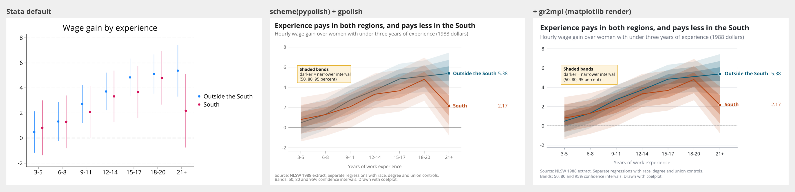
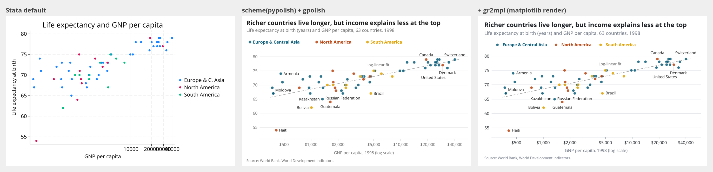
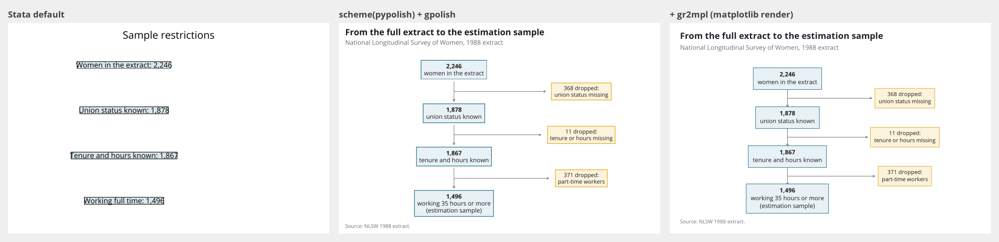

# gpolish

**Make Stata graphs look like the clean charts people build in Python and R.** `gpolish` edits a Stata graph after it is drawn: it labels lines directly, places notes and point labels where they fit, and tidies the axes and title. A companion command, `gr2mpl`, redraws any supported Stata graph in matplotlib when you want effects Stata cannot draw.


*Left: the default graph. Right: the same data with `scheme(pypolish)` and three `gpolish` commands. Both are Stata graphs.*

## What is in the package

| Piece | What it does | Output |
|---|---|---|
| `scheme(pypolish)` | Static defaults: white background, left-aligned titles, light horizontal grid, horizontal axis labels, a restrained palette. | Stata graph |
| `gpolish` | Reads the drawn graph and adds direct labels, callouts, point labels and brackets, placed by a layout step that avoids markers, lines and other text. | Stata graph |
| `gr2mpl` | Redraws the graph held in memory with matplotlib, including every `gpolish` edit. Handles `graph bar`, box, dot, `by()` and combined graphs too. | PNG |

`gpolish` needs only Stata. `gr2mpl` needs Python with matplotlib and numpy.

## Install

```stata
net install gpolish, from("https://raw.githubusercontent.com/ericabooth/gpolish-stata-public/main/") replace
help gpolish
```

Requires Stata 16 or later. One install brings both commands, the scheme and the help files.

For `gr2mpl`, check the Python setup once:

```stata
gr2mpl doctor
```

It reports which interpreter it will use and prints the `pip install` line if matplotlib is missing. To choose an interpreter, put `global GR2MPL_PYTHON "/path/to/python"` in your `profile.do`.

## Quick start

```stata
sysuse uslifeexp, clear
graph set window fontface "Open Sans"      // any installed font
line le_wfemale le_wmale le_bfemale le_bmale year, scheme(pypolish) legend(off) ///
    xsize(7) ysize(4.6) title("Life expectancy rose for every group", size(13.5pt))

gpolish                                    // bold title, drop the y-axis line and ticks
gpolish endlabel, values dots              // direct labels, pushed apart where they collide
gpolish callout "1918 influenza" "pandemic", to(1918.6 30.6)   // placed automatically

graph export life.png, width(2400) replace // still a Stata graph
gpolish render, saving(life_mpl.png) replace    // optional matplotlib version
```

| Command | Use |
|---|---|
| `gpolish` | Bold title; remove the y-axis line and tick marks. |
| `gpolish endlabel` | Label each line at its end in the line's colour; `values`, `dots`, `wrap()`, `side(left)`, `color()`. Running it again replaces the earlier labels. |
| `gpolish callout` | A note with a curved arrow. Leave out `at()` and it finds its own place. |
| `gpolish note` | A shaded box for a finding or call-out, with an optional arrow. |
| `gpolish brace` | A curly brace with a label: mark a confidence interval, a gap or a range. |
| `gpolish arrow` | A straight or curved arrow; with `note` it builds simple flow charts. |
| `gpolish ptlabel` | Label chosen scatter points, each in the least crowded of eight positions; crowded labels move out on a leader line. |
| `gpolish bracket` | A square bracket between two y values. |
| `gpolish legend` | Colour legend text to match its keys. |
| `gpolish clear` | Remove everything the layout commands added, and undo `endlabel`'s margin and legend changes. |
| `gpolish render` | Hand the finished graph to `gr2mpl`. |
| `gpolish limits` | List what Stata's renderer cannot draw. |
| `gpolish geom` | Report the drawn geometry (size, plot box, data-to-device transform) in `r()`, for programmers. |

Positions in `at()`, `to()` and `from()` may be expressions, so a note on a date axis can be written `to(td(21sep2001) 966)`.

Because `gpolish` reads the drawn graph and not your command, it also works on graphs made by other commands that produce twoway graphs, such as `marginsplot`.

## Gallery

Twenty-two examples, each drawn three ways: Stata's default, `pypolish` + `gpolish`, and the `gr2mpl` render.

- **[Browse the gallery](https://ericabooth.github.io/gpolish-stata-public/gallery/)** (page with full-size images and code)
- [Gallery on GitHub](gallery/README.md)









The gallery covers lines, scatters, `marginsplot`, coefficient and added-variable plots, histograms, bars, box plots, `by()` panels, combined graphs, a flow chart, a heatmap, a scatterplot matrix, a dendrogram, and output from the community commands `coefplot`, `statplot` and `heatplot`.

All gallery images come from one script, [gallery/gallery.do](gallery/gallery.do).

## When to use which

| | `pypolish` + `gpolish` | `gr2mpl` |
|---|---|---|
| Result | A Stata graph: editable, combinable, exports to any format | A PNG |
| Needs | Stata 16+ | Stata 16+, Python, matplotlib, numpy |
| Graph families | twoway (title edit on any family) | twoway, bar, box, dot, matrix, `by()`, combine |
| Ceiling | Stata's renderer | Anything matplotlib can draw |

Start with the scheme and `gpolish`. Use `gr2mpl` when a chart needs something from the list below, or when the graph is not a twoway graph.

## Limits

Stata's graph renderer cannot draw the following. `gpolish` prints a note for text at an unsupported angle, for inline colour tags in the graph title, and when `ptlabel` or an automatically placed callout cannot place every label without overlap; it names `gpolish render` where that can help.

- **Text at an angle other than 0, 90 or 270 degrees.** The angle is stored in the graph and applied by `gr2mpl`.
- **A soft halo behind text.** `halo` draws a white box in Stata, which can cover a nearby marker; `gr2mpl` draws a thin outline instead.
- **Different colours inside one line of text**, and **filled arrow heads**.
- **Layout commands on non-twoway graphs.** `endlabel`, `callout`, `note`, `arrow`, `brace`, `bracket`, `ptlabel`, `legend` and `clear` stop with an error on graphs that are not twoway graphs. Plain `gpolish` (or `gpolish style`) still makes the title bold, and `gpolish render` (gr2mpl) can redraw bar, box, dot, `by()` and combined graphs.

`gr2mpl` does not draw contour plots or pie charts, and does not read a second x axis or a third y axis. Skipped layers are named in a note and in `r(unsupported)`.

Two further cautions:

- Both commands rely on undocumented parts of Stata's graph objects and on `gr_edit`. A future Stata release could change them. [docs/OBJECT_MODEL.md](docs/OBJECT_MODEL.md) records what is used.
- Label spacing depends on the font. `gpolish` has width tables for 16 common fonts and falls back to Arial's widths, with a note, for any other.

## Tests

Run from the repository root.

| Script | What it checks |
|---|---|
| `tests/gpolish_battery.do` | Assertions on counts, positions, repel spacing, colours, log axes, refusals. |
| `tests/gr2mpl_tests.do` | About 40 graphs across plot families, each exported by Stata and by `gr2mpl`. |
| `gallery/gallery.do` | The gallery itself. |
| `tests/reference/` | Two hand-written matplotlib charts used as targets during development. |

Tested on StataNow 19.5 and Stata 16.1 on macOS. Stata 17 and 18 and Windows are untested.

## Repository layout

| Path | Contents |
|---|---|
| `src/` | The installed files: both commands, help files, the renderer script, the scheme. |
| `build/` | `gpolish.ado` is generated from `gpolish_template.ado` and the font-width tables by `make_ado.py`. Edit the template, not `src/gpolish.ado`. |
| `gallery/` | Gallery script, images, page. |
| `docs/` | Technical notes on Stata's graph object model. |
| `tests/` | Test scripts and reference charts. |

## How well does the placement work?

The [benchmark](benchmark/) scores `gpolish ptlabel` against Stata's own `mlabel()`, `labrepel`, adjustText (Python) and ggrepel (R) on four real-data scenarios and 60 synthetic ones, with every label measured by the same rule. When a subset of points is labelled, the usual case in a report, `gpolish` places the largest share of labels cleanly of all five methods: 84 to 100 percent. When every point in a crowded scatter is labelled, it leads ggrepel in three of four scenarios and trails it badly in the fourth, and ggrepel usually keeps labels nearer their points. `gpolish`'s placement settings were tuned on separate scenarios from the ones reported.


## Works with other graph commands

`gpolish` and `gr2mpl` read the finished graph, so they work with commands that build on Stata's own graph families. Checked in the gallery or the tests: `marginsplot`, `avplot`, `rvfplot`, `lvr2plot`, `cluster dendrogram`, `histogram`, `coefplot`, `heatplot` and `statplot`. `statplot` and other `graph bar` based commands take the scheme and the title edit inside Stata and the full restyle from `gr2mpl`.

## Author and license

Eric A. Booth, Sr Researcher, Texas 2036 (eric.a.booth@gmail.com).

Issues and suggestions: [github.com/ericabooth/gpolish-stata-public/issues](https://github.com/ericabooth/gpolish-stata-public/issues)

MIT. See [LICENSE](LICENSE). Copyright (c) 2026 Eric A. Booth.

## Acknowledgments

Asjad Naqvi ([@asjadnaqvi](https://github.com/asjadnaqvi)) and his open-source Stata graphics packages (`schemepack`, `graphfunctions` and others) informed the approach to labels and schemes.
