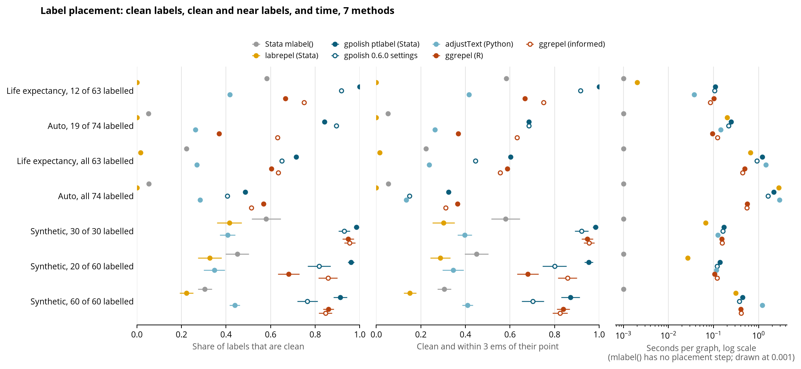

# Label-placement benchmark

This benchmark measures how well five methods place point labels on a scatterplot. It compares `gpolish ptlabel` with Stata's own marker labels, with `labrepel` (the other Stata tool for this), and with the two standard tools outside Stata: adjustText for Python and ggrepel for R.



Full tables are in [results/summary.md](results/summary.md). Per-graph and per-label scores are in [results/graphs.csv](results/graphs.csv) and [results/labels.csv](results/labels.csv), and the tuning results are in [results/tuning.csv](results/tuning.csv).

## What it shows

`gpolish`'s six settings were chosen from 566 candidates on separate tuning seeds alone (see [Tuning](#tuning)), but the test data did influence them in three ways. First, 0.6.0's hand-set values, which are one point of the stage-1 grid and fixed its ring spacing at 0.9 for stages 1 to 3, were picked from trial runs on three of the four real-data scenarios and on synthetic test seeds 1 to 6. Second, the tuning objective was revised once after looking at test-set images. Third, the method itself was developed with this benchmark in view. The best setting after stage 3 was also run on the four real-data scenarios, and its scores are reported under Tuning.

- **Against the other Stata options, `gpolish` is clearly better.** It has the highest share of clean labels of the three Stata methods in every scenario: between 1.7 and 16 times the share for Stata's default `mlabel()`.
- **When a subset of points is labelled, `gpolish` is the best of all five methods.** That is the common case in a report: 12 of 63 countries, 19 of 74 cars, or 20 of 60 synthetic points. There 84 to 100 percent of its labels are clean and 68 to 100 percent are clean and within 3 ems of their point. The figures for ggrepel are 37 to 68 percent on both measures.
- **When every point is labelled, `gpolish` leads in three of four scenarios and trails badly in one.** It is ahead of ggrepel on both measures with every country labelled (0.70 against 0.60 clean) and in both all-labelled synthetic designs (for example 0.93 against 0.86 clean with 60 points). With every car labelled it is well behind: 0.34 against 0.59 clean, and 0.20 against 0.36 clean and near. Its failures there are mostly labels touching markers (35 percent of labels against 20 for ggrepel) and overlapping pairs (31 against 16), not fit-line crossings (14 percent against 18).
- **`gpolish` usually places labels farther from their points than ggrepel.** Its mean distance is 0.7 to 2.4 ems, against 0.3 to 2.4 for ggrepel; it is farther in six of seven scenarios and level with every car labelled.
- **It takes 0.1 to 2.0 seconds per graph,** against 0.1 to 1.2 for ggrepel and 0.02 to 1.1 for adjustText.

## Design

**Scenarios.** Each scenario is a scatterplot with some points labelled.

| Scenario | Points | Labelled | Fit line | Graphs |
|---|---|---|---|---|
| Life expectancy and log GNP per capita (Stata `lifeexp`), the 12 gallery countries | 63 | 12 | yes | 1 |
| The same, every country | 63 | 63 | yes | 1 |
| Mileage and weight (Stata `auto`), every fourth car by weight | 74 | 19 | yes | 1 |
| The same, every car | 74 | 74 | yes | 1 |
| Synthetic: three Gaussian clusters, all labelled | 30 | 30 | no | 20 test seeds |
| Synthetic: three clusters, a third labelled | 60 | 20 | no | 20 test seeds |
| Synthetic: three clusters, all labelled | 60 | 60 | no | 20 test seeds |

Synthetic labels are made-up names of 4 to 14 characters. Every graph is 7 × 4.6 inches, with labels in Open Sans at 8.6 points and markers set to 6 points across (`msize(6pt)`). Stata draws such a marker as a disc of radius 3.24 points whose outer half point is a white outline, so its coloured part ends about 2.74 points from the centre.

**Same geometry for every method.** Stata draws each scenario first, and its plot region and axis scales are exported. The adjustText and ggrepel versions are drawn on a plot region of exactly the same size and position, with the same axis ranges, so all five methods face the same crowding.

**Methods, each at its defaults except where the table says otherwise.**

| Method | Call |
|---|---|
| Stata `mlabel()` | `scatter ..., mlabel() mlabposition(3)`: Stata's default label position |
| `labrepel` 1.0 (in graphfunctions 1.7, SSC) | `set seed 12345` then `labrepel y x, label() mlabsize() xsize() ysize() seed(12345)`. `labrepel` only computes positions (`_xcoord`, `_ycoord`); the benchmark draws each label there with `mlabposition(0)` and a thin `pcspike` leader line back to its point. That drawing is the benchmark's choice, since the help file gives none. `labrepel` 1.0 accepts `seed()` but does not use it, so the seed is set before each call. |
| `gpolish ptlabel` 0.6.1 | `gpolish ptlabel label, x(x) y(y) size(8.6) msize(6)` |
| adjustText 1.4.0 | `adjust_text(texts, x=..., y=..., iter_lim=100, time_lim=None, arrowprops=...)`, told about every data point. It runs a fixed 100 iterations instead of its default 1-second time limit, so that every run gives the same positions (see [Caveats](#caveats)). `arrowprops` only draws its leader lines. |
| ggrepel 0.9.8 | `geom_text_repel(..., max.overlaps = Inf)`, so it drops no labels |

**One measuring rule.** Every label box is measured the same way, with matplotlib's text extent for the font and size actually used. For the Stata methods the position and alignment of each label are read from the exported SVG; for adjustText from the finished figure; for ggrepel from the label centres read back from the drawn grid objects.

## Metrics

For each label:

| Metric | Definition |
|---|---|
| Overlaps a label | its box intersects another label's box by more than 0.25 pt² |
| Touches a marker | its box comes closer than 2.75 pt to any data point, including its own: a 6 pt marker's radius less a 0.25 pt tolerance |
| Crosses the fit line | its box (shrunk by 0.5 pt) intersects the fitted line |
| Outside the plot | its box extends more than 0.5 pt past the plot region |
| Clean | none of the four above |
| Clean and near | clean, and no more than 3 ems from its own point |
| Distance | gap between its own point and the nearest edge of its box, in ems (multiples of the font size) |
| Ambiguous | another data point is more than 1 pt closer to the box than its own point |
| Seconds | time for the placement step |

The two headline measures are the share of clean labels and the share of clean labels near their point.

## Tuning

`gpolish ptlabel` has six placement settings, kept in one function in the code (`_gpl_placeparms()`):

- the number of rings searched when a label moves out on a leader line, and the spacing of those rings;
- the cost of a spot away from the point, and how that cost grows with distance (searched as pairs);
- the label box height and the padding around each box.

They were chosen with [tune.py](tune.py) on separate **tuning scenarios**: synthetic seeds 101 to 110 for each of the three synthetic designs, 30 graphs drawn by the same process as the test seeds. The choice among the 566 candidate settings used the tuning scenarios alone. The test data did shape the starting grid and the objective, as the points of process below describe.

- **Objective:** the mean, across the three designs, of the share of labels that are clean and within 3 ems of their point.
- **Search:** 566 settings in five stages, all on the tuning scenarios. Stage 1 is a grid of 420. Later stages extended ranges whose best value sat at an edge and narrowed or fixed the others; stage 3 also added an intermediate distance cost (0.05 with 0.005), which the final setting uses. The ring spacing was held at 0.9 label heights in stages 1 to 3 and varied only in stages 4 and 5.
- **Stopping rule:** stop when extending the ranges gains less than 0.01. The rule was set after stage 4 and before stage 5. The gains from stages 2 to 5 were 0.020, 0.006, 0.014 and 0.001. Stage 3's gain was already below the threshold, so had the rule been set from the start the search would have stopped at stage 3, at the setting discussed below. Stage 5 gained 0.001, so the search stopped there.
- **Result:** 9 rings spaced 0.4 label heights apart; a far spot costs 0.05 label heights squared plus 0.005 per label height of distance; box height 0.4 times the font size with 3 points of padding. On the tuning set it scores 0.93 on the objective (clean-and-near shares of 0.97, 0.88 and 0.95 in the three designs); pooled over all 1,100 tuning labels, 92 percent are clean and near. The ring spacing of 0.4 is the smallest value tried.
- **Precision:** the ten best settings score within 0.006 of each other on the tuning set, so the exact choice among them matters little.

**How well the tuning carried over.** On the synthetic test seeds the tuned settings do slightly better than on the tuning seeds (a mean clean-and-near share of 0.94 against 0.93). The real-data results are mixed. Compared with the previous release, 0.6.0, whose settings were set by hand, the clean share rose from 0.54 to 0.70 with every country labelled, stayed at 1.00 for the 12 countries, and fell from 0.89 to 0.84 for 19 cars and from 0.47 to 0.34 with every car labelled. The scorer and the other methods' results did not change, so these figures compare directly. The best setting after stage 3 of this same search (9 rings spaced 0.9 label heights apart, the final distance cost, and a box height of 0.6 times the font size with 2.5 points of padding) was also run on the four real-data graphs. Its clean shares were 0.92 for the 12 countries, 0.76 with every country labelled, 0.89 for 19 cars and 0.59 with every car labelled, against 1.00, 0.70, 0.84 and 0.34 for the final setting. Its clean-and-near shares were 0.92, 0.63, 0.68 and 0.28, against 1.00, 0.63, 0.68 and 0.20. So it has the higher clean share on three of the four graphs and is level or higher on clean and near on three of four. The final setting scores higher on the tuning objective (0.93 against 0.92 clean and near), though not on the clean share alone (0.94 against 0.95), and it scores 0.34 on the all-cars graph. Its losses there come from labels touching markers and overlapping each other, not from the fit line; the life-expectancy graph also has a fit line and improved. One possible reason is that the final setting uses a smaller collision box (0.4 times the font size plus 3 points of padding, against 1.4 times plus 0.6 points in 0.6.0) and tighter rings, which may suit the synthetic clusters better than a 74-label crowd. The gap is reported here rather than tuned away, since changing the settings after seeing it would use the test data to choose them.

Points of process a reader should know:

- **The starting point was set by hand on test data.** 0.6.0's settings (6 rings spaced 0.9 label heights apart; a far spot costing 0.6 label heights squared plus 0.08 per label height of distance; box height 1.4 times the font size with 0.6 points of padding) were picked by hand from trial runs on three real-data scenarios (every country, every car and 19 cars) and on synthetic test seeds 1 to 6 of the 60-point all-labelled design. That setting is one point of the stage-1 grid, and its ring spacing of 0.9 was the only spacing tried in stages 1 to 3.
- **The objective was revised once.** Stages 1 and 2 were designed and run while the objective was the clean share alone. The setting that objective chose sent many labels out on long leader lines, which the test-set images made obvious. The 3-em condition was then added, stages 1 and 2 were scored again under it, and stages 3 to 5 were designed and run under the revised objective. The final settings were not chosen on test data, but the objective was changed after looking at test output.
- **The method was developed with this benchmark in view.** The leader-line fallback and the box-height correction were added after early benchmark runs showed where `gpolish` failed. Only the six numeric settings were tuned on held-out data.
- **A crash was fixed during tuning.** A leader-line check failed when a candidate leader crossed no obstacle at all. No tuning or benchmark run hit it (every run completed every graph), and the fix does not change any placement.

## Caveats

- **`labrepel` is shown at its defaults.** It starts each label centred on its point and moves it only when labels collide. With few labels nothing collides, so labels stay on top of their markers; that is why its clean share is near zero in the 12-label case. Its `nudgex()`, `nudgey()` and `direction()` options would change this, and a user tuning it would do better.
- **adjustText runs a fixed number of iterations, not its default.** With neither `time_lim` nor `iter_lim` set, adjustText 1.4.0 stops after 1 second of wall-clock time, so its placements, and so its scores, depend on the machine and its load. Two back-to-back runs of that default on the same Mac gave different positions in 39 of 64 graphs. The benchmark sets `iter_lim=100` and `time_lim=None`, and two runs then give identical positions. In a check on the real-data graphs and two seeds per synthetic design, the 1-second default reached 37 to 106 iterations on the crowded graphs with every point labelled (every country, every car, 60 synthetic points) and about 1,100 with 19 cars or 20 of 60 synthetic points labelled; the other graphs finished in under 15 iterations. With 100 iterations, 51 of the 64 graphs stop at the limit and 13 finish earlier. adjustText's result does not settle as iterations increase: from 100 to 4,000 iterations its clean share ranged from 0.26 to 0.43 with every car labelled and from 0.27 to 0.37 with every country labelled. Its mean clean shares in the synthetic designs moved by 0.01 or less between 100 and 1,000 iterations.
- **ggrepel's and adjustText's scores depend on the marker rule.** In the results reported here, 62 percent of ggrepel's labels sit 3.0 to 3.25 points from their own point: outside the 2.75-point rule, but inside the 3.24-point disc Stata draws. [marker_sensitivity.py](marker_sensitivity.py) rescores every graph with other distances. With the distance set to the radius exactly (3.0 points), ggrepel's clean shares change by 0.02 or less, `gpolish`'s by 0.03 or less, and adjustText's by up to 0.17 (0.42 to 0.25 for the 12 countries). With Stata's full drawn radius (3.24 points), ggrepel's clean shares fall sharply, for example from 0.86 to 0.32 with 60 synthetic points labelled and from 0.67 to 0.00 for the 12 countries. adjustText's fall by up to 0.33 and `gpolish`'s by 0.04 or less. The 2.75-point rule is used because the coloured part of a Stata marker ends at about that distance and ggrepel draws its own markers a little under 6 points across, but the comparison with ggrepel depends on it.
- **adjustText was not told about the fit line.** Only `gpolish` treats plotted lines as obstacles by default. ggrepel and adjustText can be given extra obstacles, but not by default.
- **Timings are not strictly comparable.** For `gpolish` they cover the whole command: reading the graph, placement and adding the labels. For `labrepel` they cover the placement only. For ggrepel they cover drawing the whole plot, because ggrepel places labels while it draws. For adjustText they cover `adjust_text()` only. All runs were on one Mac.
- **The ambiguity measure ignores leader lines.** A label moved away from its point can sit nearer another point and count as ambiguous, even though its leader line shows which point it belongs to. Every method except `mlabel()` draws leader lines for labels it moves.
- **Text widths in `gpolish` come from built-in tables.** Stata reports no text metrics, so `gpolish` estimates widths from per-font character tables. The benchmark measures the real rendered boxes, so any error in those estimates shows up in the scores.

## Running it

From this folder:

```bash
python make_synthetic.py                    # data/: test seeds 1 to 20 and tuning seeds 101 to 110
stata-mp -b do run_stata.do                 # out/stata/: default, gpolish, labrepel; real-data scenarios
python run_adjusttext.py                    # out/adjusttext/
Rscript run_ggrepel.R                       # out/ggrepel/
python score.py                             # results/labels.csv, results/graphs.csv
python summarize.py                         # results/summary.md, results/benchmark.png
python marker_sensitivity.py                # results/marker_sensitivity.md
python tune.py stata-mp 6                   # optional: results/tuning.csv (about 50 minutes on 6 workers)
python selftest.py stata-mp                 # optional: checks of the pipeline itself, on a copy of this folder
```

Requirements:

- **Stata 16 or later**, with this package's `src` folder and `labrepel`. `run_stata.do` puts `src` first on the ado path, prints which `gpolish` it uses, and stops if that is not the copy in `src`. To install `labrepel`, run `ssc install graphfunctions`. The environment variable `BENCH_PLUS` names another ado folder to search for it; that folder is added after `src`. `BENCH_METHODS` (for example `gpolish`) reruns only some methods; `run_adjusttext.py` and `run_ggrepel.R` read the geometry of the `default` method, so it must have been run. If `labrepel` is not installed, `run_stata.do` skips it and the later steps leave it out.
- **Python** with matplotlib, numpy and adjustText.
- **R** with ggplot2 and ggrepel.
- **The Open Sans font.**

`BENCH_SCENARIOS` (for example `"life12 syn60all_s01 syn60all_s02"`) limits every step to the named scenarios, for a quick check of the pipeline; `summarize.py` then reports only the designs present, and its results replace the full ones in `results/`.

`python score.py --check life12` writes `out/check_life12.png`, which shows each method's rendered image for one scenario with the measured label boxes drawn over it in red, so a box that does not match its drawn label stands out. Rendered images are kept for the real-data scenarios and synthetic seed 1; for other scenarios the boxes are drawn over the data points alone.

`data/` and `out/` are generated and not kept in the repository.
