# gpolish gallery

Twenty-one Stata graphs, each drawn three ways: Stata's default look, the same graph with `scheme(pypolish)` and `gpolish` (still a Stata graph), and that graph redrawn in matplotlib by `gr2mpl`.

Every image is produced by [gallery.do](gallery.do). A browsable version is at <https://ericabooth.github.io/gpolish-stata-public/gallery/>.

## Multi-series lines

Direct end labels with a value column replace the legend. The two notes are placed automatically.

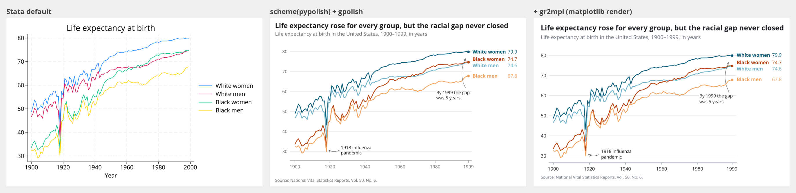

<details><summary>Stata code for the polished versions</summary>

```stata
line le_wfemale le_wmale le_bfemale le_bmale year, scheme(pypolish) legend(off) xsize(7) ysize(4.6) ///
    lcolor("11 93 122" "111 177 199" "184 67 15" "240 163 94") ///
    title("Life expectancy rose for every group, but the racial gap never closed", size(13.5pt)) ///
    subtitle("Life expectancy at birth in the United States, 1900–1999, in years", size(10pt)) ///
    note("Source: National Vital Statistics Reports, Vol. 50, No. 6.", size(8pt)) ///
    xtitle("") ytitle("") ylabel(30(10)80, labsize(9pt)) xlabel(1900(20)1980 1999, labsize(9pt)) yscale(range(28 83))
gpolish
gpolish endlabel, values dots
gpolish callout "1918 influenza" "pandemic", to(1918.6 30.6)
gpolish callout "By 1999 the gap" "was 5 years", to(1997.3 77.2)
gr2mpl, saving(figure.png) replace
```

</details>

## Labelled scatter on a log axis

Point labels pick the least crowded of eight positions and avoid the fit line. Legend text takes the colour of its key.

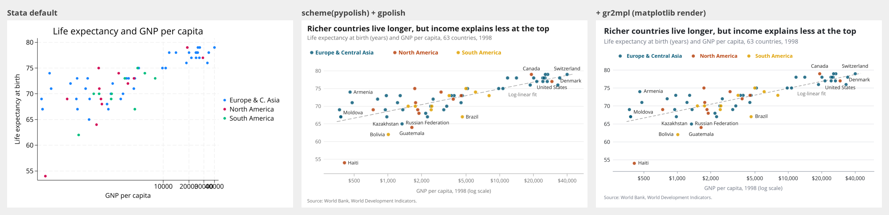

<details><summary>Stata code for the polished versions</summary>

```stata
twoway (function y = `a' + `b'*ln(x), range(350 45000) lcolor("154 154 154") lpattern(dash) lwidth(medium)) ///
       (scatter lexp gnppc if region==1, mcolor("11 93 122%85") mlcolor(white) mlwidth(vthin) msize(6pt)) ///
       (scatter lexp gnppc if region==2, mcolor("184 67 15%85") mlcolor(white) mlwidth(vthin) msize(6pt)) ///
       (scatter lexp gnppc if region==3, mcolor("224 161 0%85") mlcolor(white) mlwidth(vthin) msize(6pt)) ///
    , scheme(pypolish) xsize(7) ysize(4.6) xscale(log range(300 52000)) yscale(range(52.5 81.5)) ///
    xlabel(500 "\$500" 1000 "\$1,000" 2000 "\$2,000" 5000 "\$5,000" 10000 "\$10,000" 20000 "\$20,000" 40000 "\$40,000", labsize(9pt)) ///
    ylabel(55(5)80, labsize(9pt)) ytitle("") xtitle("GNP per capita, 1998 (log scale)", size(9pt)) ///
    title("Richer countries live longer, but income explains less at the top", size(13.5pt)) ///
    subtitle("Life expectancy at birth (years) and GNP per capita, 63 countries, 1998", size(10pt)) ///
    note("Source: World Bank, World Development Indicators.", size(8pt)) ///
    legend(order(2 "Europe & Central Asia" 3 "North America" 4 "South America") rows(1) position(11) span ///
           size(9.5pt) region(lstyle(none) margin(zero)) symxsize(*.4) keygap(*.5) colgap(*2.5) bmargin(b+2))
gpolish
gpolish legend, plots(2 3 4)
gpolish ptlabel country if inlist(country, "Haiti", "United States", "Switzerland", "Bolivia", "Russian Federation", "Moldova") ///
    | inlist(country, "Armenia", "Brazil", "Kazakhstan", "Canada", "Guatemala", "Denmark"), x(gnppc) y(lexp)
gpolish callout "Log-linear fit", to(9000 74.6) color("107 107 107") size(8.6) noarrow
gr2mpl, saving(figure.png) replace
```

</details>

## marginsplot

A graph built by another command. gpolish reads the drawn graph, so the same end labels work.

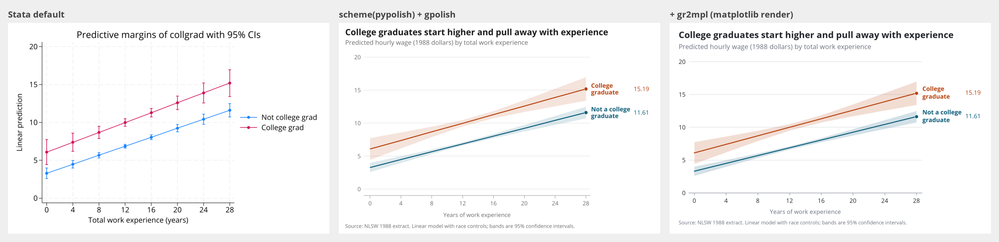

<details><summary>Stata code for the polished versions</summary>

```stata
marginsplot, scheme(pypolish) recast(line) recastci(rarea) ciopts(color(%18) lwidth(none)) legend(off) xsize(7) ysize(4.6) ///
    title("College graduates start higher and pull away with experience", size(13.5pt)) ///
    subtitle("Predicted hourly wage (1988 dollars) by total work experience", size(10pt)) ///
    note("Source: NLSW 1988 extract. Linear model with race controls; bands are 95% confidence intervals.", size(8pt)) ///
    xtitle("Years of work experience", size(9pt)) ytitle("") xlabel(, labsize(9pt)) ylabel(, labsize(9pt))
gpolish
gpolish endlabel, values format(%4.2f) dots labels("Not a college graduate" "College graduate") wrap(8)
gr2mpl, saving(figure.png) replace
```

</details>

## One series highlighted

Context series in gray, one in colour, and only that one labelled.

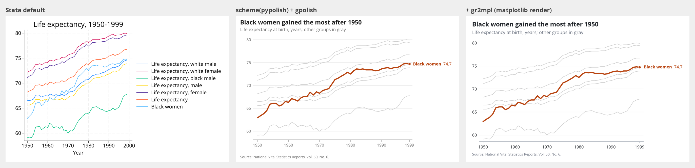

<details><summary>Stata code for the polished versions</summary>

```stata
local g "205 205 205"
line le_wmale le_wfemale le_bmale le_male le_female le le_bfemale year if year>=1950, scheme(pypolish) legend(off) xsize(7) ysize(4.6) ///
    lcolor("`g'" "`g'" "`g'" "`g'" "`g'" "`g'" "184 67 15") lwidth(medium medium medium medium medium medium thick) ///
    title("Black women gained the most after 1950", size(13.5pt)) ///
    subtitle("Life expectancy at birth, years; other groups in gray", size(10pt)) ///
    note("Source: National Vital Statistics Reports, Vol. 50, No. 6.", size(8pt)) ///
    xtitle("") ytitle("") xlabel(1950(10)1990 1999, labsize(9pt)) ylabel(, labsize(9pt))
gpolish
gpolish endlabel, plots(7) values dots
gr2mpl, saving(figure.png) replace
```

</details>

## Scatter with fit and confidence band

Selected points labelled; the legend becomes a coloured key above the plot.

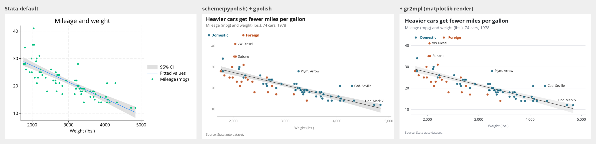

<details><summary>Stata code for the polished versions</summary>

```stata
twoway (lfitci mpg weight, lcolor("60 60 60") lwidth(medium) fcolor("225 225 225") alcolor("225 225 225")) ///
       (scatter mpg weight if !foreign, mcolor("11 93 122%85") mlcolor(white) mlwidth(vthin) msize(6pt)) ///
       (scatter mpg weight if foreign,  mcolor("184 67 15%85") mlcolor(white) mlwidth(vthin) msize(6pt)) ///
    , scheme(pypolish) xsize(7) ysize(4.6) ///
    title("Heavier cars get fewer miles per gallon", size(13.5pt)) ///
    subtitle("Mileage (mpg) and weight (lbs.), 74 cars, 1978", size(10pt)) note("Source: Stata auto dataset.", size(8pt)) ///
    xtitle("Weight (lbs.)", size(9pt)) ytitle("") xlabel(, labsize(9pt) format(%9.0fc)) ylabel(, labsize(9pt)) ///
    legend(order(3 "Domestic" 4 "Foreign") rows(1) position(11) span size(9.5pt) region(lstyle(none) margin(zero)) ///
           symxsize(*.4) keygap(*.5) colgap(*2.5) bmargin(b+2))
gpolish
gpolish legend, plots(3 4)
gpolish ptlabel make if inlist(make, "VW Diesel", "Linc. Mark V", "Plym. Arrow", "Cad. Seville", "Subaru"), x(weight) y(mpg)
gr2mpl, saving(figure.png) replace
```

</details>

## Daily time series

A callout placed by the layout step at the series minimum.

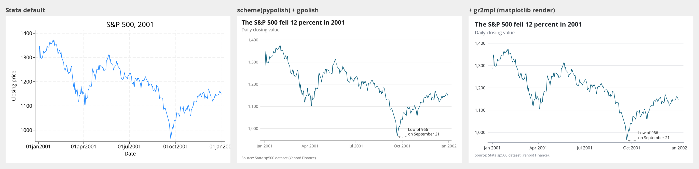

<details><summary>Stata code for the polished versions</summary>

```stata
quietly summarize close
local lo = r(min)
quietly summarize date if close==`lo'
local dlo = r(mean)
line close date, scheme(pypolish) legend(off) xsize(7) ysize(4.6) lcolor("11 93 122") lwidth(medium) ///
    title("The S&P 500 fell 12 percent in 2001", size(13.5pt)) subtitle("Daily closing value", size(10pt)) ///
    note("Source: Stata sp500 dataset (Yahoo! Finance).", size(8pt)) ///
    xtitle("") ytitle("") ylabel(, labsize(9pt) format(%9.0fc)) xlabel(, labsize(9pt) format(%tdMon_CCYY)) graphregion(margin(r+5))
gpolish
gpolish callout "Low of `=strtrim("`: display %4.0f `lo''")'" "on `: display %tdMonth_dd `dlo''", to(`dlo' `lo')
gr2mpl, saving(figure.png) replace
```

</details>

## Coefficient plot

Built from twoway rcap and scatter. The scheme and the title edit do the work.

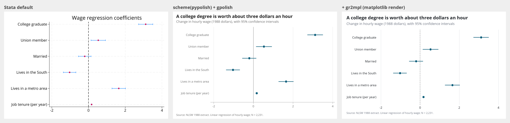

<details><summary>Stata code for the polished versions</summary>

```stata
twoway (rcap lo hi k, horizontal lcolor("11 93 122") lwidth(medthick) msize(zero)) ///
       (scatter k b, mcolor("11 93 122") mlcolor(white) mlwidth(vthin) msize(7pt)) ///
    , scheme(pypolish) legend(off) xsize(7) ysize(4.6) ylabel(`yl', labsize(9pt) nogrid) yscale(range(0.5 6.5)) ///
    xline(0, lcolor("120 120 120") lwidth(thin)) xlabel(, labsize(9pt) grid glcolor("228 228 228") glwidth(thin)) ///
    title("A college degree is worth about three dollars an hour", size(13.5pt)) ///
    subtitle("Change in hourly wage (1988 dollars), with 95% confidence intervals", size(10pt)) ///
    note("Source: NLSW 1988 extract. Linear regression of hourly wage; N = 2,231.", size(8pt)) xtitle("") ytitle("")
gpolish
gr2mpl, saving(figure.png) replace
```

</details>

## Histogram

A note with a curved arrow; text position given by hand here.

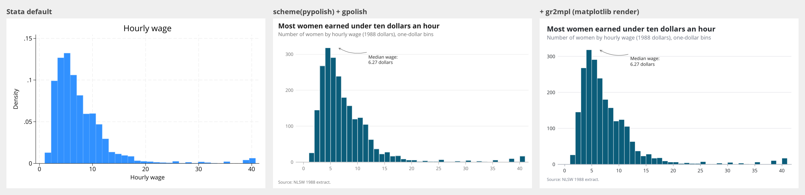

<details><summary>Stata code for the polished versions</summary>

```stata
quietly summarize wage, detail
local med = r(p50)
histogram wage, scheme(pypolish) width(1) start(0) frequency xsize(7) ysize(4.6) ///
    title("Most women earned under ten dollars an hour", size(13.5pt)) ///
    subtitle("Number of women by hourly wage (1988 dollars), one-dollar bins", size(10pt)) ///
    note("Source: NLSW 1988 extract.", size(8pt)) xtitle("") ytitle("") xlabel(0(5)40, labsize(9pt)) ylabel(, labsize(9pt))
gpolish
gpolish callout "Median wage:" "`: display %4.2f `med'' dollars", at(12 285) to(`med' 318) curve(0.2)
gr2mpl, saving(figure.png) replace
```

</details>

## Ranked horizontal bars

graph hbar is not a twoway graph: the scheme and the bold title apply, the layout commands do not. gr2mpl redraws it.

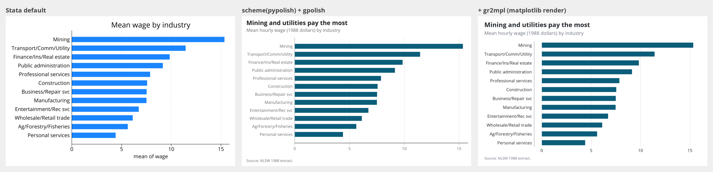

<details><summary>Stata code for the polished versions</summary>

```stata
graph hbar (mean) wage, over(industry, sort(1) descending label(labsize(9pt))) scheme(pypolish) xsize(7) ysize(4.6) ///
    title("Mining and utilities pay the most", size(13.5pt)) subtitle("Mean hourly wage (1988 dollars) by industry", size(10pt)) ///
    note("Source: NLSW 1988 extract.", size(8pt)) ytitle("") ylabel(, labsize(9pt))
gpolish
gr2mpl, saving(figure.png) replace
```

</details>

## Box plot

Same split as the bar chart: scheme and title inside Stata, full restyle from gr2mpl.

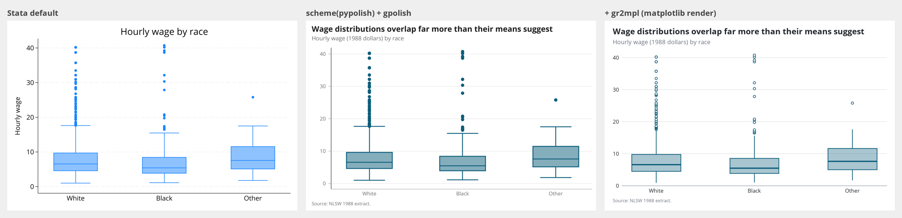

<details><summary>Stata code for the polished versions</summary>

```stata
graph box wage, over(race, label(labsize(9pt))) scheme(pypolish) xsize(7) ysize(4.6) ///
    title("Wage distributions overlap far more than their means suggest", size(13.5pt)) ///
    subtitle("Hourly wage (1988 dollars) by race", size(10pt)) note("Source: NLSW 1988 extract.", size(8pt)) ///
    ytitle("") ylabel(, labsize(9pt))
gpolish
gr2mpl, saving(figure.png) replace
```

</details>

## Small multiples with by()

The scheme removes the shaded panel strips. gr2mpl gives bold panel titles and shared axes.

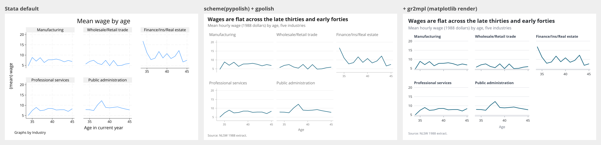

<details><summary>Stata code for the polished versions</summary>

```stata
line wage age, scheme(pypolish) lcolor("11 93 122") xtitle("Age", size(9pt)) ytitle("") xlabel(, labsize(9pt)) ylabel(, labsize(9pt)) ///
    by(industry, title("Wages are flat across the late thirties and early forties", size(13.5pt)) ///
       subtitle("Mean hourly wage (1988 dollars) by age, five industries", size(10pt)) ///
       note("Source: NLSW 1988 extract.", size(8pt))) xsize(7) ysize(4.6)
gpolish
gr2mpl, saving(figure.png) replace
```

</details>

## Combined panels

graph combine of four graphs, each styled by the scheme; gr2mpl redraws every panel.

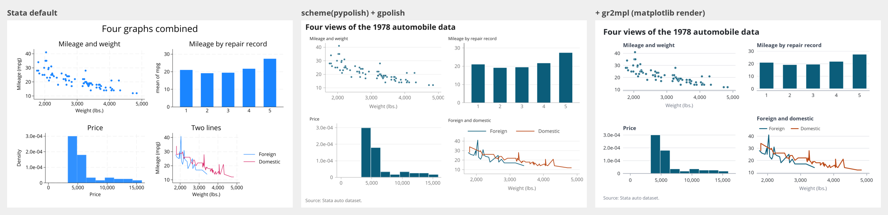

<details><summary>Stata code for the polished versions</summary>

```stata
local o scheme(pypolish) nodraw
scatter mpg weight, `o' mcolor("11 93 122%85") mlcolor(white) mlwidth(vthin) title("Mileage and weight", size(10pt)) xtitle("Weight (lbs.)") ytitle("") name(c1, replace)
graph bar (mean) mpg, over(rep78) `o' title("Mileage by repair record", size(10pt)) ytitle("") name(c2, replace)
histogram price, `o' title("Price", size(10pt)) xtitle("") ytitle("") name(c3, replace)
line mpg weight if foreign, sort || line mpg weight if !foreign, sort `o' title("Foreign and domestic", size(10pt)) ///
    legend(order(1 "Foreign" 2 "Domestic") rows(1) position(11) region(lstyle(none))) xtitle("Weight (lbs.)") ytitle("") name(c4, replace)
graph combine c1 c2 c3 c4, scheme(pypolish) xsize(7) ysize(4.6) title("Four views of the 1978 automobile data", size(13.5pt)) note("Source: Stata auto dataset.", size(8pt))
gpolish
gr2mpl, saving(figure.png) replace
```

</details>

## Finding box, brace and callout

Three overlays on one scatter: a shaded finding box, a curly brace marking a range, and a callout that finds its own place.

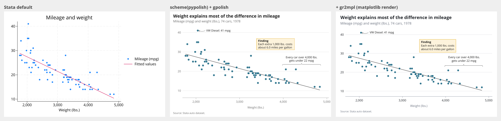

<details><summary>Stata code for the polished versions</summary>

```stata
twoway (lfit mpg weight, lcolor("60 60 60") lwidth(medium)) ///
       (scatter mpg weight, mcolor("11 93 122%85") mlcolor(white) mlwidth(vthin) msize(6pt)) ///
    , scheme(pypolish) legend(off) xsize(7) ysize(4.6) title("Weight explains most of the difference in mileage", size(13.5pt)) ///
    subtitle("Mileage (mpg) and weight (lbs.), 74 cars, 1978", size(10pt)) note("Source: Stata auto dataset.", size(8pt)) ///
    xtitle("Weight (lbs.)", size(9pt)) ytitle("") xlabel(, labsize(9pt) format(%9.0fc)) ylabel(, labsize(9pt)) yscale(range(8 42))
gpolish
gpolish note "{bf:Finding}" "Each extra 1,000 lbs. costs" "about `slope' miles per gallon", at(3350 34)
gpolish brace "Every car over 4,000 lbs." "gets under 22 mpg", from(3980 23) to(4860 23)
gpolish callout "VW Diesel: 41 mpg", to(2040 41)
gr2mpl, saving(figure.png) replace
```

</details>

## Group means with confidence-interval braces

One brace names the confidence interval; another measures the gap between the two means.

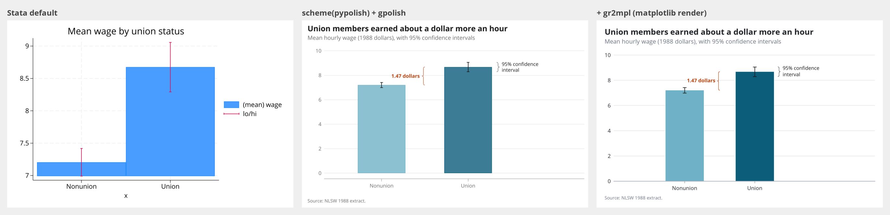

<details><summary>Stata code for the polished versions</summary>

```stata
local m1 = m[1]
local m2 = m[2]
local lo2 = lo[2]
local hi2 = hi[2]
local gap = strtrim("`: display %4.2f `m2'-`m1''")
twoway (bar m x if x==1, barwidth(0.55) color("111 177 199")) (bar m x if x==2, barwidth(0.55) color("11 93 122")) ///
       (rcap lo hi x, lcolor("26 26 26") lwidth(medium)) ///
    , scheme(pypolish) legend(off) xsize(7) ysize(4.6) xlabel(1 "Nonunion" 2 "Union", labsize(9pt)) xscale(range(0.4 3.3)) ///
    ylabel(0(2)10, labsize(9pt)) yscale(range(0 10)) xtitle("") ytitle("") ///
    title("Union members earned about a dollar more an hour", size(13.5pt)) ///
    subtitle("Mean hourly wage (1988 dollars), with 95% confidence intervals", size(10pt)) note("Source: NLSW 1988 extract.", size(8pt))
gpolish
gpolish brace "95% confidence" "interval", from(2.33 `lo2') to(2.33 `hi2') flip width(5)
gpolish brace "{bf:`gap' dollars}", from(1.5 `m1') to(1.5 `m2') width(5) color("184 67 15") lcolor("184 67 15")
gr2mpl, saving(figure.png) replace
```

</details>

## Flow chart of sample restrictions

Boxes and arrows on an empty plot, built from gpolish note and gpolish arrow. The counts come from the data.

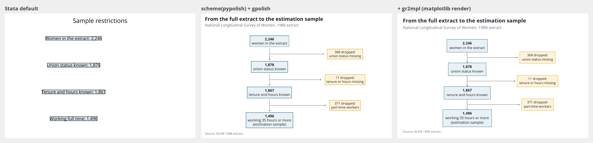

<details><summary>Stata code for the polished versions</summary>

```stata
scatter y x, msymbol(none) scheme(pypolish) xscale(off range(0 100)) yscale(off range(0 100)) ///
    xlabel(, nogrid) ylabel(, nogrid) xsize(7) ysize(4.6) plotregion(margin(zero)) ///
    title("From the full extract to the estimation sample", size(13.5pt)) ///
    subtitle("National Longitudinal Survey of Women, 1988 extract", size(10pt)) note("Source: NLSW 1988 extract.", size(8pt))
gpolish, keepyline keepyticks
local main fill("232 241 245") border("11 93 122") align(center) size(9.5) pad(7)
local drop fill("253 243 220") border("224 161 0") align(center) size(8.8) pad(6)
gpolish note "{bf:`n0'}" "women in the extract", at(35 90) `main'
gpolish note "{bf:`n1'}" "union status known", at(35 64) `main'
gpolish note "{bf:`n2'}" "tenure and hours known", at(35 38) `main'
gpolish note "{bf:`n3'}" "working 35 hours or more" "(estimation sample)", at(35 10) `main'
gpolish note "`d1' dropped:" "union status missing", at(76 77) `drop'
gpolish note "`d2' dropped:" "tenure or hours missing", at(76 51) `drop'
gpolish note "`d3' dropped:" "part-time workers", at(76 25) `drop'
gpolish arrow, from(35 83) to(35 71)
gpolish arrow, from(35 57) to(35 45)
gpolish arrow, from(35 31) to(35 19)
gpolish arrow, from(35 77) to(64.5 77) headsize(3.5)
gpolish arrow, from(35 51) to(63 51) headsize(3.5)
gpolish arrow, from(35 25) to(65.5 25) headsize(3.5)
gr2mpl, saving(figure.png) replace
```

</details>

## Correlation heatmap

Tiles drawn with twoway rbar, cell values as marker labels, and a legend used as the colour key.

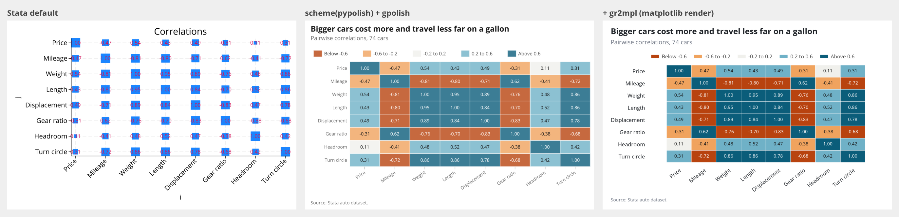

<details><summary>Stata code for the polished versions</summary>

```stata
local c1 "184 67 15"
local c2 "240 163 94"
local c3 "240 240 236"
local c4 "111 177 199"
local c5 "11 93 122"
local layers
forvalues k = 1/5 {
    local layers `layers' (rbar y0 y1 i if bin==`k', barwidth(1) color("`c`k''") lcolor(white) lwidth(vthin))
}
twoway `layers' ///
       (scatter j i if inlist(bin, 2, 3, 4), msymbol(none) mlabel(rtxt) mlabpos(0) mlabsize(8pt) mlabcolor("26 26 26")) ///
       (scatter j i if inlist(bin, 1, 5), msymbol(none) mlabel(rtxt) mlabpos(0) mlabsize(8pt) mlabcolor(white)) ///
    , scheme(pypolish) xsize(7) ysize(4.6) yscale(reverse) xlabel(`al', labsize(8pt) angle(35) nogrid) ylabel(`al', labsize(8pt) nogrid) ///
    xtitle("") ytitle("") xscale(noline) plotregion(margin(zero)) ///
    title("Bigger cars cost more and travel less far on a gallon", size(13.5pt)) ///
    subtitle("Pairwise correlations, 74 cars", size(10pt)) note("Source: Stata auto dataset.", size(8pt)) ///
    legend(order(1 "Below -0.6" 2 "-0.6 to -0.2" 3 "-0.2 to 0.2" 4 "0.2 to 0.6" 5 "Above 0.6") rows(1) position(11) span ///
           size(8.5pt) region(lstyle(none) margin(zero)) symxsize(*.35) keygap(*.5) colgap(*1.6) bmargin(b+1))
gpolish
gr2mpl, saving(figure.png) replace
```

</details>

## Scatterplot matrix

graph matrix is its own graph family: the scheme and the bold title apply, and gr2mpl redraws it.

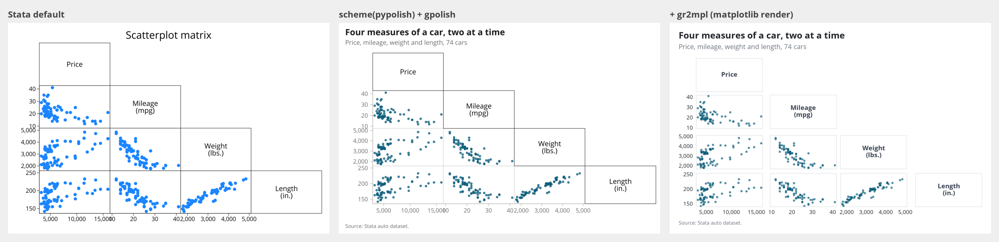

<details><summary>Stata code for the polished versions</summary>

```stata
graph matrix price mpg weight length, half scheme(pypolish) xsize(7) ysize(4.6) mcolor("11 93 122%70") msize(3.5pt) ///
    title("Four measures of a car, two at a time", size(13.5pt)) subtitle("Price, mileage, weight and length, 74 cars", size(10pt)) ///
    note("Source: Stata auto dataset.", size(8pt))
gpolish
gr2mpl, saving(figure.png) replace
```

</details>

## Cluster dendrogram

cluster dendrogram produces a twoway graph, so the scheme and gpolish apply directly.

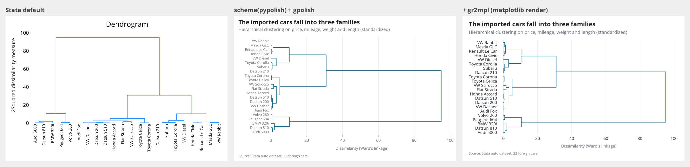

<details><summary>Stata code for the polished versions</summary>

```stata
cluster dendrogram w, labels(make) horizontal scheme(pypolish) xsize(7) ysize(4.6) lcolor("11 93 122") lwidth(medium) ///
    ylabel(, labsize(8pt) nogrid) xlabel(, labsize(9pt) grid glcolor("228 228 228") glwidth(thin)) xtitle("Dissimilarity (Ward's linkage)", size(9pt)) ytitle("") ///
    title("The imported cars fall into three families", size(13.5pt)) ///
    subtitle("Hierarchical clustering on price, mileage, weight and length (standardized)", size(10pt)) ///
    note("Source: Stata auto dataset, 22 foreign cars.", size(8pt))
gpolish
gr2mpl, saving(figure.png) replace
```

</details>

## Added-variable plot

A regression diagnostic from avplot, with the coefficient stated in a finding box.

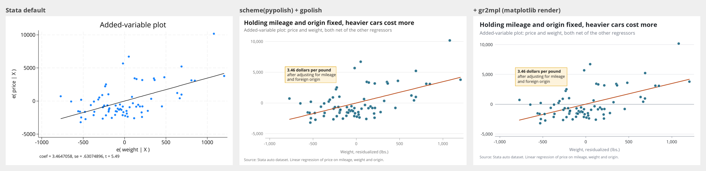

<details><summary>Stata code for the polished versions</summary>

```stata
local b = strtrim("`: display %4.2f _b[weight]'")
avplot weight, scheme(pypolish) xsize(7) ysize(4.6) mcolor("11 93 122%85") mlcolor(white) mlwidth(vthin) msize(6pt) ///
    rlopts(lcolor("184 67 15") lwidth(medthick)) note("Source: Stata auto dataset. Linear regression of price on mileage, weight and origin.", size(8pt)) ///
    title("Holding mileage and origin fixed, heavier cars cost more", size(13.5pt)) ///
    subtitle("Added-variable plot: price and weight, both net of the other regressors", size(10pt)) ///
    xtitle("Weight, residualized (lbs.)", size(9pt)) ytitle("") xlabel(, labsize(9pt) format(%9.0fc)) ylabel(, labsize(9pt) format(%9.0fc))
gpolish
gpolish note "{bf:`b' dollars per pound}" "after adjusting for mileage" "and foreign origin", at(-850 4600)
gr2mpl, saving(figure.png) replace
```

</details>

## statplot

statplot output is a graph hbar. The scheme and title edit apply inside Stata; gr2mpl redraws it with its group labels.

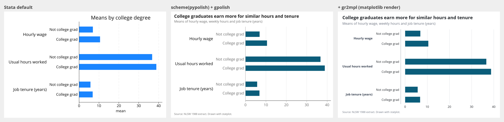

<details><summary>Stata code for the polished versions</summary>

```stata
statplot wage hours tenure, over(collgrad) scheme(pypolish) xsize(7) ysize(4.6) ///
    title("College graduates earn more for similar hours and tenure", size(13.5pt)) ///
    subtitle("Means of hourly wage, weekly hours and job tenure (years)", size(10pt)) note("Source: NLSW 1988 extract. Drawn with statplot.", size(8pt)) ytitle("")
gpolish
gr2mpl, saving(figure.png) replace
```

</details>

## heatplot

A two-way density from the community command heatplot, with its colour key.

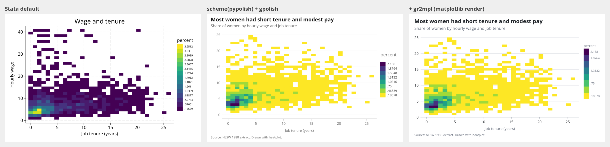

<details><summary>Stata code for the polished versions</summary>

```stata
heatplot wage tenure if wage < 25, scheme(pypolish) xsize(7) ysize(4.6) color(viridis, reverse) levels(8) ///
    legend(position(3) cols(1) rows(8) region(lstyle(none)) size(8pt)) ///
    title("Most women had short tenure and modest pay", size(13.5pt)) subtitle("Share of women by hourly wage and job tenure", size(10pt)) ///
    note("Source: NLSW 1988 extract. Drawn with heatplot.", size(8pt)) xtitle("Job tenure (years)", size(9pt)) ytitle("") ///
    xlabel(, labsize(9pt)) ylabel(, labsize(9pt))
gpolish
gr2mpl, saving(figure.png) replace
```

</details>
